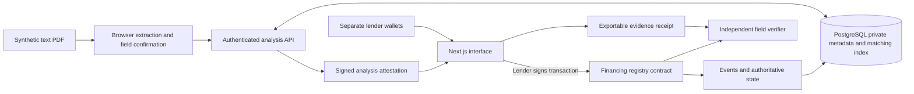
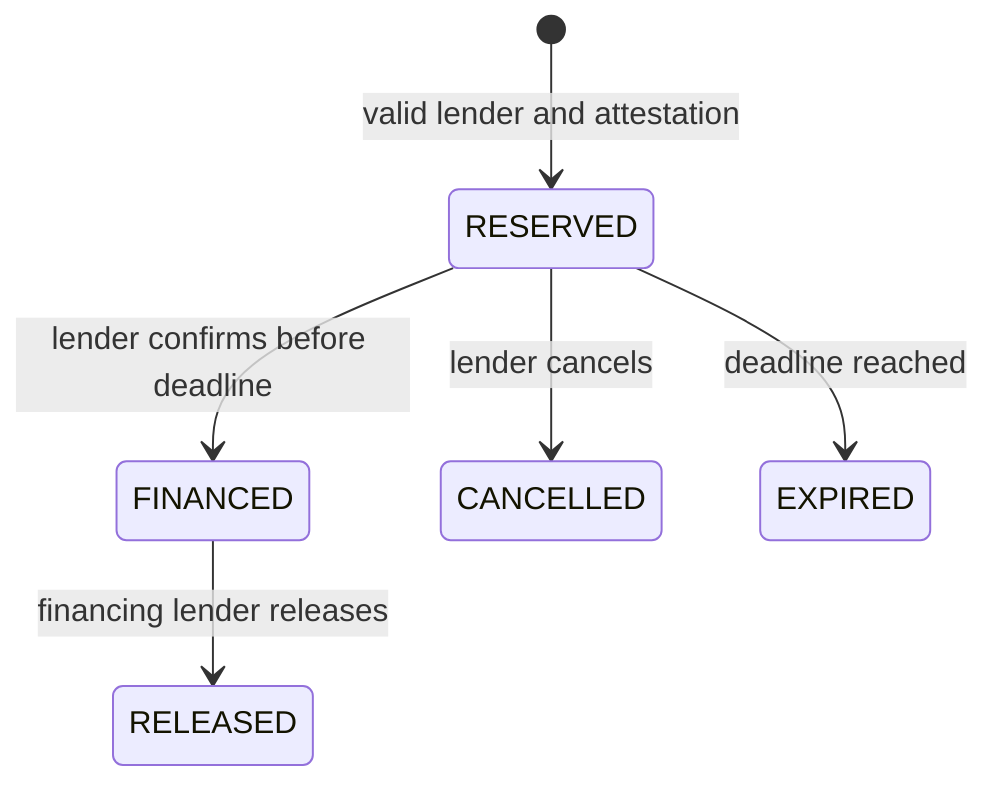

# A Blockchain Registry for Duplicate Invoice Financing Detection and Verifiable Financing Claims

**Project specification and implementation guide**  
**Course:** Blockchain & its Applications  
**Team and duration:** Two developers; four weeks  
**Prepared:** 24 October 2026  
**Status:** Proposed design. Performance targets are not experimental results.

> A smart contract governs invoice-financing claims across simulated lenders. An off-chain service detects exact and altered invoice reuse. Cryptographic receipts let reviewers verify selected evidence independently.

## Contents

1. [Overview](#1-overview)
2. [Problem statement and verified industry context](#2-problem-statement-and-verified-industry-context)
3. [Scope and success criteria](#3-scope-and-success-criteria)
4. [Blockchain versus PostgreSQL](#4-blockchain-versus-postgresql)
5. [Portfolio contribution and prior art](#5-portfolio-contribution-and-prior-art)
6. [Complete stack and zero-cost verification](#6-complete-stack-and-zero-cost-verification)
7. [Architecture and cryptographic representations](#7-architecture-and-cryptographic-representations)
8. [Smart-contract specification](#8-smart-contract-specification)
9. [End-to-end application flow](#9-end-to-end-application-flow)
10. [Data model and interfaces](#10-data-model-and-interfaces)
11. [Detection and dataset methodology](#11-detection-and-dataset-methodology)
12. [Security and evaluation](#12-security-and-evaluation)
13. [Course outcomes and syllabus alignment](#13-course-outcomes-and-syllabus-alignment)
14. [Four-week plan](#14-four-week-plan)
15. [Deliverables and acceptance checklist](#15-deliverables-and-acceptance-checklist)
16. [References](#16-references)

## 1. Overview

The project addresses a coordination failure in trade finance: a lender may not know that another lender has financed the same underlying invoice or receivable. Participating lenders need a shared account of active financing claims and a way to investigate documents that have been reformatted or altered.

Blockchain is an application authority, rather than an optional timestamping feature. The contract decides whether a reservation is valid, whether financing can be confirmed, and who may cancel or release a claim. PostgreSQL supports analysis and search but cannot override accepted on-chain financing state.

| Component | Responsibility | Output |
|---|---|---|
| Analysis service | Extract/normalise invoice data; identify exact and potential altered duplicates | Matching token, reasons, review disposition, signed submission attestation |
| Financing contract | Enforce authorised transitions and one effective active claim per recognised identifier | Authoritative claim state and historical events |
| Evidence verifier | Verify selected disclosed fields against a recorded commitment | Reproducible valid/invalid evidence result |

This is a university prototype using synthetic invoices. It is not a regulated lending platform, legal collateral registry, or production integration with banks.

## 2. Problem statement and verified industry context

### 2.1 Detailed problem statement

Duplicate financing fraud occurs when a borrower obtains undisclosed financing from multiple lenders against the same underlying trade or receivable. Documents such as invoices, bills of lading, and warehouse receipts may be reused or altered. Separate bank systems and confidentiality restrictions can prevent lenders from cross-checking already financed transactions. ICC United Kingdom identifies this information-sharing gap as an opportunity exploited by fraudsters. [R1]

The scale of broader trade-finance fraud is material, but precise global measurement is difficult. Trade Finance Global attributes to MonetaGo a statement that more than US$10 billion of trade-finance losses have been publicly identified since 2020. This is an attributed industry claim covering broader fraud, not an independently audited total or a figure specifically for duplicate financing. It is cumulative, not an annual loss estimate. [R2]

ICC UK's recommendations describe an estimate of 1% of a US$5 trillion trade-finance market—US$50 billion—being susceptible to various forms of fraud. The related ICC Germany/MonetaGo white paper explicitly frames its calculation as hypothetical and acknowledges a lack of public data on total global trade-fraud costs. This project therefore treats US$50 billion as illustrative exposure under an assumption, not a measured global fraud rate, established upper bound, or realised annual losses. [R3, R4]

ICC UK reports an estimated four billion paper documents circulating through the trade system at any given time. This is an industry estimate rather than a precise present-day census. Paper and digital documents can be copied, altered, or fraudulently reused. Merely hashing PDF bytes cannot reliably recognise a business invoice after formatting or metadata changes because cryptographic hashes intentionally change when their inputs change. [R5, R6]

Existing systems demonstrate commercial relevance. MonetaGo's service has operated since 2018; ICC UK describes availability through Swift's API Gateway to the network's 11,000+ institutions. This denotes potential access, not adoption by every institution. Singapore's Association of Banks launched its Trade Finance Registry on 23 June 2023 as a centralised utility to mitigate duplicate financing. [R1, R7, R8]

The proposed project implements a blockchain-governed invoice-financing registry combining normalised matching, explainable similarity alerts, financing-lifecycle controls, and verifiable evidence receipts. It evaluates both the benefits and limits of these mechanisms across simulated lenders.

### 2.2 Claim audit

| Claim | Defensible wording | Wording to avoid |
|---|---|---|
| US$10 billion since 2020 | MonetaGo claim reported by TFG; broader cumulative publicly identified trade-finance losses | Duplicate financing alone causes US$10 billion annually |
| 1% / US$50 billion | Illustrative exposure under an assumption applied to a US$5 trillion portfolio | Exactly/up to 1% are proven fraudulent; US$50 billion of annual realised losses |
| Four billion documents | ICC estimate of documents circulating at a given time | A verified current or annual count |
| Qingdao, 2014 | Multibillion-dollar collateral-financing scandal involving fake warehouse receipts and multiple loans | Precisely established US$3 billion realised loss |
| Service since 2018 | MonetaGo service production history | The later global Swift service launched in 2018 |
| Swift reach | Potential access through a channel serving 11,000+ institutions | All those institutions use the registry |
| First global registry | A positioning claim made by MonetaGo | Independently established historical priority |

Qingdao is useful supporting context, but its figures require caution. GTR distinguishes international losses thought to exceed US$1 billion from Chinese banks' exposure exceeding US$3 billion. Exposure must not be equated with realised losses. [R9]

### 2.3 Architectural history

MonetaGo currently describes encryption and confidential computing; BIS documents hashing and confidential cloud computing. Earlier implementations used permissioned Hyperledger Fabric and Corda, and GTR reported a move away from blockchain in 2022. Do not imply that this problem inherently requires blockchain or that MonetaGo's relevant previous design was a public chain. [R10, R11, R12]

## 3. Scope and success criteria

### 3.1 Required four-week scope

- Commercial invoices with extractable text and at least three synthetic layouts.
- Three simulated lenders with independent wallets, a registry administrator, and a read-only investigator experience.
- Raw-file matching, normalised invoice-identity matching, and structured similarity alerts.
- Reservation, financing confirmation, cancellation, expiry, and release.
- Mandatory signed analysis attestations for new reservations.
- Salted field commitments and exportable selective-disclosure evidence receipts.
- A fully local deployment and a small Amoy deployment if no-purchase test tokens are obtainable.
- A small PostgreSQL reference implementation for evaluation, separate from authoritative chain state.
- Reproducible security tests, held-out detection evaluation, and documented limitations.

### 3.2 Exclusions

Exclude real disbursement, interest calculation, loan servicing, legal priority, partial financing, syndication, assignment chains, production KYC, supplier authentication, cross-chain coordination, and real-bank integration. Bills of lading and scanned-document OCR are stretch goals. No cryptocurrency token, NFT, DAO, or mining implementation is necessary.

One active claim per recognised invoice is an explicit simplified policy. Legitimate financing structures can be more complex. A duplicate relationship or similarity alert does not, by itself, establish fraudulent intent.

### 3.3 Acceptance principles

1. A conflicting exact-identifier claim cannot succeed by bypassing the UI.
2. State-changing lender operations are signed by that lender.
3. Stale database state cannot override contract enforcement.
4. Changing a disclosed field after commitment makes its proof fail.
5. Similarity results explain signals and leave ambiguity to review.
6. Claims of accuracy, privacy, novelty, and cost do not exceed evidence.

## 4. Blockchain versus PostgreSQL

### 4.1 Correct justification

Confidential cross-bank comparison establishes a need for shared verification, not necessarily blockchain. A neutral industry operator can maintain a confidential database; Singapore's registry illustrates this governance model. [R7, R13]

This project explores an additional requirement: participants should independently verify accepted claim history and enforcement of transition rules without depending exclusively on the application operator's database. Blockchain supplies the shared authority for recorded state. Its justification is verifiable history, signatures, and ordering under the chosen network's assumptions. NCSC likewise recommends evaluating distributed ledgers against trust requirements and database alternatives. [R14]

| Dimension | Neutral PostgreSQL registry | Blockchain-backed application |
|---|---|---|
| Accepted state | Operator-managed database transactions | Contract execution under network consensus |
| Concurrent exact claims | Transactions and uniqueness constraints enforce exclusivity | Atomic contract transitions enforce exclusivity |
| Authentication | Application signatures and permissions | Wallet signatures, contract roles, private API sessions |
| Altered-document matching | Off-chain extraction, indexing, and scoring | The same off-chain mechanisms |
| Privacy | Requires data protection and access controls | Requires controls; public chain adds observable metadata |
| Historical integrity | Logs, signed receipts, backups, and witnesses strengthen it | Accepted contract history independently inspectable, subject to finality and administration assumptions |
| Correction | Controlled updates and compensating records | Explicit compensating transitions; public history remains |
| Operation | Flexible queries; generally simpler | Adds RPC, transactions, gas, confirmations, and reconciliation |
| Operator dependence | Central governance of integrity and availability | Reduced dependence on its state database; analysis and token issuance remain trusted |
| Appropriate fit | Participants accept neutral operator | Participants value independent rule/history verification enough to accept complexity |

PostgreSQL already supports atomic conflict handling. The project must not claim only blockchain can prevent racing inserts. [R15]

### 4.2 Architecture decision

Use a **permissioned application on a public EVM testnet**: approved lenders write to the contract, but the underlying network and transaction history are public. This is not a private consortium blockchain. The team neither operates Amoy validators nor implements its consensus.

The non-upgradeable MVP contract is authoritative for financing claims. PostgreSQL holds private submitted data, candidate indexes, analysis outcomes, and a rebuildable chain projection. A database edit cannot change a FINANCED claim in the contract. Decisions must read chain state or submit an operation that atomically enforces it.

Administrators manage lender membership, but cannot overwrite claims or release another lender's financing. Their membership authority and the analysis signer are explicit governance dependencies.

### 4.3 Precise guarantee and limits

The contract enforces **at most one effective active claim per recognised matching token within one deployment**. It cannot establish:

- That an invoice or shipment is genuine.
- That all lenders participate or all financing is registered.
- That different identifiers representing the same receivable will always be linked.
- That a lender's financing declaration corresponds to a payment.
- That first registration creates legal title or priority.
- That testnet measurements predict production capacity.

Without the analysis service, altered-document detection disappears. Without PostgreSQL, private metadata and search availability disappear. Without the contract, the application's shared claim-state enforcement disappears. These are distinct responsibilities.

## 5. Portfolio contribution and prior art

### 5.1 Established contribution claim

> An evaluated blockchain application for duplicate invoice financing that combines exclusive active claims, lender-controlled financing lifecycles, explainable altered-invoice detection, and selectively disclosable evidence receipts. Its distinctive contribution is the integrated implementation, adversarial benchmark, and evaluation of the boundary between on-chain enforcement and off-chain document analysis.

This is an engineering and evaluation contribution, not new cryptography, first-ever duplicate detection, or demonstrated commercial superiority.

| Prior art | Consequence |
|---|---|
| MonetaGo and Singapore's registry already detect duplicate financing | Rebuilding the core registry alone is not novel |
| MonetaGo describes identifying identical or similar documents [R16] | Near-duplicate detection cannot be claimed unprecedented |
| Centrifuge provides field-level Merkle proofs with invoice examples [R17] | Merkle-based field disclosure is established |
| A community draft describes Merkle disclosure proofs [R18] | This pattern predates the project; that draft is not a ratified W3C standard |

The demonstration should show which mutations evade file hashing, how structured matching performs, how concurrent claims are resolved, and which modifications are exposed by independent receipts and chain records.

### 5.2 Selective disclosure: exact meaning

A Merkle proof establishes that a disclosed field belongs to committed values. It does not prove that hidden fields match another invoice, that a fuzzy score was correctly computed, or that the document is authentic. Do not call this zero-knowledge matching.

## 6. Complete stack and zero-cost verification

### 6.1 What all-free means

The complete core can run with **no mandatory software licence fee, paid API, purchased cryptocurrency, cloud subscription, or dedicated GPU**. This assumes existing computers and internet access; electricity and connectivity are not claimed costless.

Distinguish three categories:

1. **No-fee local software:** the reproducible fallback, without hosted quotas after installation.
2. **Free hosted tiers:** usable within limits and permitted use, not unlimited infrastructure.
3. **Conditional testnet resources:** advertised free tokens/access can depend on eligibility and availability.

Verification on 24 October 2026 checked official documentation, pricing, licences, or publisher package metadata. It did **not** include account creation, successful faucet claims, or a deployed application. Recheck conditions in week one and record actual versions and allowances.

### 6.2 Implementation tools

| Layer | Selected tool | No-fee evidence | Implementation choice |
|---|---|---|---|
| Runtime/language | Node.js, TypeScript, npm | Node source/licence; TypeScript Apache-2.0 [T1, T2] | One supported Node LTS release for both developers |
| Frontend/API | React, Next.js, plain CSS | React and Next.js MIT licences [T3, T4] | One app with Node-runtime route handlers; no second hosted backend |
| Contracts | Solidity compiler | Open-source compiler, no purchased compilation service [T5] | Pin compiler, optimiser, and EVM target compatible with network/dependencies |
| Contract development | Hardhat 3 and compatible ethers tooling | Publisher package identifies MIT licence [T6] | Use a compatible template; do not mix Hardhat 2 plugins |
| Contract components | OpenZeppelin Contracts | MIT licence [T7] | Roles, typed signatures, and proof utilities |
| EVM client | ethers.js | MIT licence [T8] | Wallets, typed data, contract calls, receipts, and events |
| Evidence tree | OpenZeppelin Merkle Tree | Project documents MIT licence and standard format [T9] | Identical generation/verification encodings |
| PDF extraction | PDF.js / pdfjs-dist | Apache-2.0 [T10] | Browser extraction, followed by user field confirmation |
| PDF generation | pdf-lib | MIT licence [T11] | Synthetic layouts and altered variants |
| Cryptography | Node crypto / browser Web Crypto | Built-in facilities; no external API | SHA-256 file digest, HMAC-SHA-256 token, cryptographic random salts |
| Database | PostgreSQL | Licence permits use without fee [T12] | Local PostgreSQL; hosted Supabase optional |
| Similarity | Project-owned TypeScript code | No external service | Edit distance, field comparisons, token overlap; CPU only |
| Testing | Hardhat tests, Vitest, Playwright | No-fee tooling; Vitest explicitly free/open source; Playwright Apache-2.0 [T13, T14] | Contract tests, detector tests, small browser smoke suite |
| Version control | Git, optional GitHub Free | Git GPLv2; GitHub Free plan [T15, T16] | Lockfile, reviews, issues, reproducible commands |
| Wallet access | Existing injected EVM wallet supporting typed signing | No paid wallet API required | Test-only browser-wallet accounts; local Hardhat accounts for deterministic testing |

Preserve dependency licence notices. Solidity compiler licensing does not imply that all application code must adopt the compiler's licence. Audit the versions actually installed rather than relying on the table as a transitive dependency audit.

Select a Node LTS release supported by Hardhat and the frontend/test dependencies; pin it in the repository. Hardhat documents its Node support separately. [T17]

### 6.3 Hosted services and conditions

| Resource | Verified offering | Constraints and decision |
|---|---|---|
| Vercel Hobby | Free personal/non-commercial plan [T18] | Non-commercial university portfolio demo, within quotas, free subdomain |
| Vercel payloads | 4.5 MB function request/response limit [T19] | Parse in browser; send small validated JSON; cap demo PDFs at 2 MB; avoid base64 uploads |
| Vercel duration | Hobby maximum documented as 300 seconds with Fluid Compute [T20] | Return promptly; browser polls for chain receipts; no persistent background indexer |
| Vercel collaboration | Public-repository collaboration free; private-repository collaboration restricted on Hobby [T21] | Personal public repository if university policy permits; otherwise designated deployer/local demo; do not assume paid team seats |
| Supabase Free | 500 MB database, 1 GB storage, 5 GB egress; two active projects; inactivity pausing [T22] | Small synthetic data; resume before demo; retain local exports |
| Alchemy Free RPC | 30 million compute units/month, 15 requests/second [T23] | Compute units are not request count; limit polling and event ranges |
| Polygon Amoy | Public testnet: chain ID 80002; token POL [T24] | No purchased tokens; access depends on no-purchase token availability |
| UN Comtrade basic individual | Free registration; up to 500 calls/day, 100,000 records/call [T25] | Cache small snapshots; no paid bulk/async API required |

No custom domain, paid object storage, paid OCR, hosted AI model, paid CI, mainnet deployment, or paid RPC is required. Run generation/benchmarks locally. Native PostgreSQL or PostgreSQL within WSL2 avoids a need for Docker or additional subscriptions.

### 6.4 Faucet correction and deployment fallback

**Correction to the earlier stack assessment:** QuickNode's current canonical faucet page states a small mainnet-balance requirement. Alchemy also documents mainnet-balance/activity checks for most faucet networks. Their drips are advertised free but are not an unconditional zero-spend path for a new empty wallet. Earlier indexed variants can show different conditions. Do not purchase mainnet assets merely to qualify. [T26, T27]

ETHGlobal's Amoy faucet advertises 0.05 POL/day behind login. This is an alternative to investigate; its public page does not prove account eligibility or successful access. [T28]

During week one, attempt an available no-purchase faucet or seek donated test tokens through university/developer resources. Such outreach is a proposed step, not an action already performed. If access fails, the entire application runs on Hardhat with synthetic funded accounts.

Local mode executes real contract code, but does not demonstrate public consensus or independent validator operation. State that distinction in the presentation. If the course requires public deployment, resolve token access early with the instructor rather than silently substituting local mode.

**Verified cost conclusion:** a no-fee implementation path exists. A hosted public-testnet demonstration is feasible but conditional; zero-spend account/token eligibility cannot be guaranteed in advance.

### 6.5 Hardware and operating environment

The stated Intel i5-12500H and 16 GB DDR5 RAM are sufficient for the scoped workload. This is an engineering feasibility assessment, not a measured benchmark. The RTX 3050 is unnecessary: hashing, extraction, edit distance, local contract execution, and several thousand synthetic records run on CPU.

Use Windows 11 with a consistent Node installation, or standardise both teammates on WSL2. Install dependencies within the chosen environment; do not share a node_modules folder across Windows and Linux. Limit test parallelism and run heavier benchmarks sequentially. Do not operate a full public-chain node.

## 7. Architecture and cryptographic representations

### 7.1 System layout



Use request-driven reconciliation and a local replay script rather than a continuously running hosted worker. Persist the last reconciled block; replay bounded ranges, retry idempotently, and retain block hashes.

### 7.2 Actors

| Actor | Authority | Boundary |
|---|---|---|
| Lender A/B/C | Reserve and manage their own permitted claims | Wallet identity is not independently verified bank identity |
| Registry admin | Grant/revoke lender membership | Cannot overwrite historical claims or release other lenders' financing |
| Analysis signer | Attest token/evidence/submission binding | Trusted for normalisation; not an authenticity oracle |
| Investigator | Inspect authorised disclosures and verify proofs | Cannot modify financing state |
| Public observer | Inspect public chain records | Sees addresses/timing, not protected private database fields |

Private API login uses a wallet-signed, one-time challenge bound to domain, address, nonce, and expiry. Consume the nonce, use a short-lived secure session, and enforce ownership on each operation. A UI role selector is not authentication.

### 7.3 Separate four representations

| Representation | Construction/purpose | Storage |
|---|---|---|
| PDF digest | SHA-256 of original bytes; exact-file baseline and integrity | Off-chain; optionally included inside a salted commitment |
| Matching token | HMAC-SHA-256 over versioned business identity | On-chain bytes32 and protected index |
| Evidence root | Salted field-level Merkle tree for one submission | On-chain root; values/salts/proofs private |
| Claim ID | Unique registry-issued ID per financing cycle | On-chain and in receipts |

Recommended identity:

```text
canonicalIdentity = encode(schemaVersion, supplierCountry,
                           supplierIdentifierType, supplierIdentifier,
                           invoiceNumberNamespace, normalisedInvoiceNumber)
matchingToken = HMAC-SHA-256(registrySecret, canonicalIdentity)
```

Use structured or length-delimited encoding rather than ambiguous concatenation. Do not include lender, amount, file hash, fresh salt, or formatting in the stable identity: those changes must not produce an easy exact-match bypass. Define invoice-number namespace within the synthetic supplier domain; invoice numbers are not globally unique.

Preserve original/normalised values. Specify Unicode, whitespace, and case rules. Do not blindly strip punctuation or leading zeros. Missing critical identity fields require review, not a random replacement identifier.

All lenders use one registry-scoped secret via the service; lender-specific secrets break cross-lender matching. The secret is server-only. Rotation changes tokens and requires a migration/alias design; freeze key and schema for the MVP and document that limitation. HMAC reduces public offline guessing of low-entropy identifiers, but not equality leakage, online probing, or backend compromise.

### 7.4 Mandatory signed attestation

Without validation, a lender could submit a random token and bypass deduplication. New reservations therefore require an analysis-service signature binding:

```text
schemaVersion, matchingToken, evidenceRoot, lenderAddress,
evidenceContext, analysisId, attestationNonce, validUntil
```

Use EIP-712 typed signing with chain ID and verifying-contract address in the domain. Verify configured signer, caller/lender equality, expiry, supported schema, nonzero required values, and unused nonce. Re-analysis issues a new nonce. A consumed attestation cannot reopen a released claim.

The signature attests approval under service policy. It does not prove supplier issuance or real-world authenticity. The contract cannot recompute a secret HMAC or inspect hidden fields; the analysis signer remains trusted for their binding.

### 7.5 Evidence format

Use OpenZeppelin StandardMerkleTree with typed leaf values:

```text
[schemaVersion, evidenceContext, fieldPath, canonicalValue, randomSalt]
```

Use at least 128 bits of independent cryptographic salt per field. Field paths distinguish supplier.id from buyer.id. A unique random evidenceContext identifies the submission and is bound by both attestation and claim. Use the library's documented encoding/hash rules, not a custom incompatible leaf formula.

The receipt includes chain ID, contract address, claim ID, schema, context, root, transaction hash, and block reference. A disclosure package adds only selected values, salts, and proofs. Keep full data and salts out of chain calldata/events.

Verify disclosures locally against the on-chain root. Submitting a private disclosure as a public transaction would reveal it. Fresh salts produce different roots for repeated invoices; this is why the root is separate from the stable matching token. Lost values/salts cannot be reconstructed from the public root.

## 8. Smart-contract specification

### 8.1 Records

Each claim stores ID, token, lender, immutable evidence root/context, schema, creation time, reservation deadline, lifecycle state, and transition times. Maintain a token-to-current-claim pointer plus historical records.

States are RESERVED, FINANCED, CANCELLED, EXPIRED, RELEASED. AVAILABLE is derived from the absence of an effective active claim; it is not a historical claim state. Every later financing cycle gets a new claim ID.

### 8.2 State machine



| Operation | Caller | Preconditions/outcome |
|---|---|---|
| reserve(attestation, signature) | Approved lender named in attestation | Valid unused approval; no effective active claim; create bounded reservation |
| confirmFinancing(claimId) | Approved claim lender | RESERVED, strictly before deadline; mark FINANCED |
| cancelReservation(claimId) | Claim lender | RESERVED before deadline; mark CANCELLED |
| expireReservation(claimId) | Anyone | RESERVED at/after deadline; mark EXPIRED |
| releaseFinancing(claimId) | Claim lender | FINANCED; mark RELEASED |
| getClaim / getEffectiveStatus | Anyone | Read evidence and actual/effective lifecycle |
| grant/revokeLender | Administrator | Membership change only; emit event |

Expiry is time-based eligibility, not an automatic background transaction. Read methods treat timed-out reservations as inactive. A new reservation can atomically finalise an old expired record before replacing the current pointer. An explicit expire transaction must not be required to unblock a token after deadline.

Choose a bounded fixed reservation period, such as 15 minutes, as a prototype policy. FINANCED has no automatic expiry: time alone must not reopen an unpaid financed invoice. A revoked lender cannot reserve or confirm, but can cancel/release its existing claims to avoid stranding them. A compromised owner's ability to release remains a documented risk.

Original root/context and lender are immutable. Corrections require a new permitted cycle; a UI edit cannot rewrite historical evidence.

### 8.3 Invariants

1. At most one effective RESERVED or FINANCED claim exists per token.
2. FINANCED cannot be replaced until RELEASED.
3. Only the recorded lender performs owner transitions.
4. Expired/terminal claims cannot be confirmed or resurrected.
5. Each successful reserve consumes exactly one valid attestation nonce.
6. A reverted reserve creates no partial state or nonce consumption.
7. Membership changes do not rewrite claims.
8. Every accepted lifecycle transition emits replayable events.

Emit ClaimReserved, FinancingConfirmed, ReservationCancelled, ReservationExpired, FinancingReleased, and membership events. Never emit plaintext fields, salts, secrets, or fuzzy fingerprints.

### 8.4 Ordering and confirmation

Execution order determines which valid competing reservation succeeds; browser submission time does not establish priority. Separate pending, included, and application-confirmed states. Configure/disclose the confirmation policy, retain block hashes, and reconcile dropped/reorganised transactions. Do not describe an arbitrary confirmation count as mathematical finality.

The prototype does not disburse funds. A real integration would coordinate banking payment execution with confirmed registry state and handle cross-system failure.

## 9. End-to-end application flow

### 9.1 Setup

1. Deploy the non-upgradeable registry and record network, address, compiler settings, and source commit.
2. Configure the attestation signer; keep its key and the HMAC secret server-only.
3. Authorise three distinct lender wallets through admin transactions.
4. Seed synthetic invoices and an explicitly synthetic institution directory.
5. Test private authentication/ownership before enabling invoice views.

### 9.2 Submission

1. Lender A connects on the correct network and signs the login challenge.
2. It selects a supported small PDF. The browser computes the digest and extracts text.
3. Show fields/warnings and require confirmation of critical identifiers. Record corrections as submitted assertions, not independent verification of PDF truth.
4. The API validates structure, lengths, dates, identifiers, and money encodings. Use integer minor units or decimal strings, not floating-point money.
5. Normalise under the frozen schema and compute the matching token. Original PDFs need not be uploaded or stored.

Client-side extraction protects the original upload path, but the backend receives confirmed fields. A malicious client can submit invented fields; attestation is not issuer authentication.

### 9.3 Analysis and review

1. Read effective chain status for the token; search private matching indexes.
2. Return exact active conflict, exact historical match, potential altered duplicate, or no detected match.
3. Provide reasons without revealing another lender's complete invoice. Service-side cross-lender search does not grant client-side cross-lender data access.
4. An active exact-token conflict cannot be overridden. Fuzzy alerts require an attributed review disposition. The lender can acknowledge a possible false positive under prototype policy; this is not independent fraud adjudication.
5. If proceeding is allowed, build the evidence commitment and issue a short-lived attestation. An analysis result is a snapshot, not a reservation.

### 9.4 Reserve and confirm

1. Lender A inspects the action and signs reserve from its own wallet.
2. The contract validates signature and current state atomically. A concurrent lender may have won after analysis.
3. Track the receipt. A revert is a conflict/error, not a financed record.
4. After the configured confirmation policy, update the projection and export reservation evidence.
5. Lender A signs confirmFinancing before expiry.
6. Show confirmed FINANCED state and retain the evidence receipt. This is a lender declaration, not an observed bank payment.

### 9.5 Duplicate scenarios

| Submission | Expected behaviour |
|---|---|
| Same PDF | Digest/token match; conflicting active claim rejected |
| Reformatted PDF | Digest changes; normalised identity/token unchanged; conflict rejected |
| Changed amount with same identity | Token unchanged; discrepancy explained; commitment records submitted amount |
| Changed invoice number | Token can change; similarity may alert; if missed, both tokens may be accepted |
| Legitimate lookalike | Review can distinguish separate invoice; no unsupported accusation |
| Same invoice after release | Historical match shown; fresh attestation and claim cycle permitted |

The changed-number case illustrates the boundary between semantic detection and exact contract enforcement. Include it in the evaluation, including failures.

### 9.6 Investigation

1. An authorised investigator obtains a permitted disclosure package.
2. The verifier reads the claim/root using network, registry address, and claim ID.
3. Check context/schema and selected field proofs.
4. Modified values, salts, or proof paths fail.
5. Explain that success establishes consistency with committed data, not trade authenticity.

Verification must not simply trust the application's mutable database root. An offline package can verify against an exported root, but independently establishing actual chain inclusion requires a chain lookup or separately authenticated chain evidence.

### 9.7 Cancellation, expiry, release

Cancel unexpired reservations through their owner wallet. Treat timed-out reservations as inactive and allow atomic cleanup on a replacement reservation. FINANCED claims require explicit owner release. Later financing uses a new analysis, attestation, and claim ID; history remains.

### 9.8 Failure handling

| Failure | Behaviour |
|---|---|
| Backend unavailable | New analysis unavailable; existing claims readable; minimal wallet-to-contract panel permits owner lifecycle actions |
| Database unavailable | No claim that similarity analysis succeeded; withhold new attestations until prerequisites recover |
| RPC unavailable | Display unavailable/pending; do not infer success |
| Chain succeeds but persistence fails | Reconcile receipt/events; do not blindly resubmit |
| Stale projection | Contract wins; rebuild projection |
| Wallet rejected | Preserve draft; no assumed reservation |
| Signer compromise | Stop new attestations; document redeployment/recovery limitations |
| Evidence package lost | Root/history persist; missing private evidence cannot be disclosed |

## 10. Data model and interfaces

### 10.1 PostgreSQL tables

| Table | Contents | Authority |
|---|---|---|
| institutions | Synthetic IDs and wallet mapping | Membership mirrored from chain |
| submissions | Owner, original/normalised fields, digest, context, schema | Private submitted information |
| match_features | Candidate-search features and submission links | Off-chain analysis |
| analyses | Ruleset, candidates, reasons, review disposition | Attributed snapshot |
| attestations | Payload, signature, nonce, expiry | Consumption confirmed on-chain |
| claim_projection | Claim/token/state and transaction/block references | Rebuildable chain cache |
| chain_events | Chain/address/tx/log index and block hash | Idempotent projection |
| evidence_packages | Values, salts, tree/proofs | Private evidence availability |
| sessions/challenges | Hashed session IDs, nonces, expiry | API authentication |

Enforce ownership and investigator permissions in every service operation and database policies where applicable. Keep privileged credentials server-only. Use a serverless-appropriate connection pool. Store only synthetic data; raw PDFs are not retained by default.

### 10.2 Interfaces

| Interface | Responsibility |
|---|---|
| POST /api/auth/challenge and /verify | Wallet login |
| POST /api/submissions | Validate confirmed extracted data |
| POST /api/submissions/:id/analyse | Exact/similarity analysis |
| POST /api/analyses/:id/review | Attributed review disposition |
| POST /api/submissions/:id/attest | Issue approved context-bound attestation |
| GET /api/claims/:id | Authorised metadata and labelled chain state |
| POST /api/claims/:id/disclosure | Export permitted field evidence |
| Local verifier | Independent receipt/proof checking |
| Local replay script | Reconcile bounded event ranges |

Reserve/confirm/cancel/expire/release are wallet-to-contract actions. Use API idempotency keys for created submissions/attestations. Verify chain, destination, receipt status, and event contents before accepting a user-provided transaction hash.

### 10.3 Repository layout

```text
apps/web/                Next.js UI and authenticated route handlers
packages/contracts/      Contracts, deployment, contract tests
packages/domain/         Schema and canonicalisation
packages/matching/       Candidate selection and scoring
packages/evidence/       Trees, receipts, independent verifier
scripts/                 Generator, snapshots, replay, benchmarks
data/synthetic/          Demo data and evaluation manifest
docs/                    Architecture, threat model, experiments
```

Use npm workspaces, one lockfile, and the same shared domain/evidence definitions in both registry adapters. Document environment-variable names without committing secrets. Keep all local/public-test keys separate from personal wallets.

## 11. Detection and dataset methodology

### 11.1 Detection layers

1. **Raw-file baseline:** SHA-256 equality.
2. **Normalised identity:** token equality from supplier/namespace/invoice identity.
3. **Structured similarity:** candidate retrieval followed by explainable comparisons.

Do not shortlist solely by exact supplier identity: supplier alterations would then become invisible. Use bounded unions such as supplier/date window, buyer/amount/currency, and invoice-number resemblance within a plausible scope. Measure candidate recall separately.

Use normalised edit distance for invoice numbers, identifier comparisons, date difference, currency equality, amount differences, and line-item token overlap. A weighted score is sufficient if weights, thresholds, missing-field behaviour, and rationale are documented. It is a heuristic, not a calibrated fraud probability. A low score does not establish authenticity.

### 11.2 Synthetic dataset

Generate approximately 1,000–5,000 base invoices with seeded randomness, several layouts, supplier/buyer entities, identifiers, dates, currencies, and plausible products. Render from source records. Keep a hidden ground-truth manifest; the evaluated extraction pipeline must read PDFs instead of receiving generator answers.

Generate labelled variants:

- Exact file reuse.
- Layout/font/whitespace/metadata changes and reordered line items.
- Changed amount/date while identity remains stable.
- One-character invoice-number changes and selected identifier substitutions.
- Multiple simultaneous changes, including cases expected to evade detection.
- Legitimate recurring invoices with similar amounts/descriptions.
- Authorised amendments, post-release invoices, and namespace edge cases.

Label same underlying invoice, distinct invoice, and legitimate amendment separately from financing status. A relationship between duplicates does not alone prove intent to defraud.

### 11.3 UN Comtrade use

UN Comtrade provides aggregate official statistics reported by nearly 200 countries/areas, with historical coverage dating to 1962. Availability varies by reporter, period, and classification. It does not supply individual invoices, bills of lading, borrower identities, or fraud labels. [T29]

Use a cached sample for plausible country–partner–commodity combinations and broad patterns. Aggregate unit values are not exact invoice prices or proof of real shipments. Record query parameters, period, classification, retrieval date, attribution, and transformations. Keep keys server-only; distribute only an appropriately attributed allowed snapshot.

### 11.4 Evaluation hygiene

Split by original invoice family before evaluating related variants so versions of the same invoice cannot leak across development/test sets. Freeze thresholds before held-out testing. Add an entity-held-out subset if time permits. Synthetic success does not establish bank-grade accuracy.

## 12. Security and evaluation

### 12.1 Threat model

Consider dishonest/mistaken approved lenders, direct contract callers, modified clients, curious public observers, and corrupted/stale database records. Trust the selected chain's consensus assumptions, cryptographic primitives, deployment, and analysis signer for token/data binding.

The backend handles extracted data. The MVP implements no confidential-computing enclave, private-set intersection, or zero-knowledge inference. A compromised signer can suppress alerts or sign incorrect identifiers; the chain cannot correct that semantic failure.

### 12.2 Required security tests

| Test | Expected outcome |
|---|---|
| Simultaneous valid reservations for one token | Exactly one succeeds |
| Outsider calls reserve | Rejected |
| Approved lender submits random token without approval | Rejected |
| Copied approval used by another lender | Caller/lender mismatch fails |
| Modified token/root/context/schema/deadline | Signature or validation fails |
| Consumed attestation reused after release | Rejected |
| Cross-chain/cross-contract replay | Domain verification fails |
| Wrong lender confirms/cancels/releases | Rejected |
| Confirm at/after deadline | Rejected |
| Reserve after timeout without separate cleanup | Atomic expiry handling permits it |
| Revoked lender starts financing | Rejected; its permitted cleanup remains available |
| Disclosed value/salt/proof changed | Proof fails |
| Cross-lender private API read | Denied or explicitly redacted |
| Database claim metadata changed | Comparison with chain detects inconsistency |
| Event ingestion dropped/repeated | Replay is recoverable/idempotent |
| Failed/reorganised transaction | No false persistent accepted state |

Test reservation squatting: authorisation and expiry limit abuse but do not prevent an approved lender from repeatedly reserving. Document the residual governance issue. Restrict costly analysis queries and online token probing. Public records still expose token equality, lender addresses, timing, and volume.

### 12.3 Metrics

| Evaluation question | Evidence |
|---|---|
| Which mutations evade each method? | Precision, recall, false-positive rate, false-negative counts by mutation |
| Does retrieval hide misses? | Candidate recall plus final scoring recall |
| Are exact claims exclusive? | Concurrent transaction outcomes and invariants |
| What is chain overhead? | Gas/operation, RPC use, submission/inclusion/application-confirmation times |
| What is analysis cost? | Extraction/matching median and p95 latency with hardware/dataset details |
| Can evidence be checked independently? | Valid/tampered receipt results without database trust |
| What survives outages? | Backend/database/RPC failure demonstrations |

Separate duplicate-relationship detection from financing-policy decisions. A released historical duplicate can be correctly detected without constituting a current conflict. Do not collapse these into one misleading accuracy number.

### 12.4 Fair PostgreSQL baseline

Keep blockchain as the main application. Implement only a small reference adapter with equivalent lifecycle rules, locks/transactions, and an active-claim uniqueness constraint. Resolve expiry transactionally before replacement. Include authentication, audit records, and signed receipts where feasible; an intentionally unprotected database is not a fair baseline.

Run full detection experiments locally and contract volume/concurrency tests on Hardhat. Use Amoy for representative scenarios, not thousands of quota-consuming transactions. Report local SQL commit, local EVM execution, and public-network confirmation separately. Testnet results do not establish production throughput or realised financial savings.

## 13. Course outcomes and syllabus alignment

### 13.1 Outcome mapping

| Outcome | Project response | Assessment evidence |
|---|---|---|
| **CO1: Understand cryptocurrency, blockchain, and DLT** | Distinguish gas/test tokens from business assets; use blocks, transactions, keys, signatures, hashes, contract state, and ordering | Annotated receipts; signature demonstration; public network versus permissioned application; local/public consensus distinction |
| **CO2: Analyze applications and impact in finance and other industries** | Apply shared state to trade finance and compare neutral registry governance | Referenced scenario, blockchain/database matrix, adoption/coverage limits; brief transfer discussion for another shared-claim use case |
| **CO3: Evaluate blockchain security issues** | Model role abuse, replay, public metadata, key compromise, squatting, finality, and incorrect inputs | Attack tests, threat model, tampered-proof demonstration, residual risks |
| **CO4: Design and analyze blockchain impact** | Define invariants, lifecycle, evidence binding, and off-chain responsibilities | Working workflow, diagrams, gas/latency/detection results, justified reference comparison |

### 13.2 Unit mapping

- **Unit I:** Keys as actor identity, signatures, hashes, transactions/blocks, blockchain types, consensus assumptions, and achieved decentralisation. Explain P2P/network concepts; the application does not itself implement them.
- **Unit II:** Direct trade-finance implementation; supply-chain financing applicability; risks and limitations. Health-insurance data transfer is outside scope.
- **Unit III:** Smart-contract architecture, deployment, platform selection, ordering, and reorganisation handling. Mining, BIPs, and SegWit can be discussed conceptually in the course context; do not claim this EVM app implements Bitcoin-specific mechanisms.

A necessary on-chain rule and clearly demonstrated limits satisfy the course more convincingly than unrelated features added only to resemble syllabus keywords.

## 14. Four-week plan

| Week | Work | Exit criterion |
|---|---|---|
| 1 | Freeze schema/token/threat model/state machine; scaffold packages; generator and extraction UI; minimal contract; attempt no-purchase Amoy access | Basic local claim works; tooling/token obstacles identified |
| 2 | Attestations, roles, full lifecycle, independent wallets, projection, race/security tests | Exact conflict blocked through direct calls; release/new cycle preserves history |
| 3 | Similarity/review, receipts/verifier, final dataset, small reference adapter | Full investigation works; thresholds ready to freeze; core scope frozen |
| 4 | Held-out experiments, fixes, UI polish, optional hosted deployment, documentation, recorded demo | Reproducible submission and dependable local fallback |

Developer A leads contracts, attestations, deployment, and chain projection. Developer B leads extraction, matching, generator, and UI. Both review token/evidence encoding and integration. Agree interfaces in week one and integrate daily.

If behind schedule, remove OCR, bills of lading, elaborate dashboards, and optional object storage first. Preserve contract correctness, lender signatures, altered-invoice explanations, receipts, tests, and limitations. Keep the reference comparison modest.

## 15. Deliverables and acceptance checklist

### 15.1 Submission package

- Source, lockfile, setup guide, environment-variable template, and seeds.
- Contract deployment metadata or reproducible local deployment, labelled by network.
- Lender/investigator UI with pending, failed, and accepted states.
- Synthetic dataset manifest and Comtrade provenance.
- Contract, matching, evidence, and selected end-to-end test results.
- Detection tables, gas measurements, latency method, and limitations.
- Architecture/state diagrams, trust model, and course mapping.
- Short walkthrough and local demo independent of cloud availability.

### 15.2 Final review

- [ ] Lender mutations originate from the appropriate lender wallet.
- [ ] Every reservation has a valid context-bound attestation.
- [ ] Exact exclusivity and lifecycle invariants pass direct-call tests.
- [ ] Token, PDF hash, root, and claim ID have separate documented purposes.
- [ ] No private fields, salts, keys, or secrets appear in public calldata/events or repository.
- [ ] Public metadata and trusted-backend limitations are stated.
- [ ] Similarity yields review alerts, not unsupported fraud verdicts.
- [ ] Evidence verification does not trust editable database roots.
- [ ] Industry figures preserve attribution and exposure/loss distinctions.
- [ ] Novelty/performance claims match collected evidence.
- [ ] Actual free-tier eligibility and fallback are documented.
- [ ] All four course outcomes are explicitly demonstrated.

## 16. References

Industry sources were consulted in this specification and the preceding fact-check; hosted-service conditions were rechecked on 24 October 2026. Sources support associated factual claims, not the correctness of the proposed unimplemented design. Secondary reporting, vendor assertions, and community drafts are identified.

### 16.1 Industry, architecture, and prior art

- **R1 — ICC United Kingdom:** [We can stop duplicate financing fraud this year](https://iccwbo.uk/we-can-stop-duplicate-financing-fraud-this-year-says-icc-uk/). Primary industry account of the problem, service history, and Swift availability. Original ambitions are not evidence of universal adoption.
- **R2 — Trade Finance Global:** [C-suite speaks: ICISA's Richard Wulff provides four reasons to digitalise trade](https://www.tradefinanceglobal.com/posts/c-suite-speaks-icisas-richard-wulff-provides-four-reasons-to-digitalise-trade/). Secondary attribution of the cumulative US$10 billion claim to MonetaGo; not an audited loss database.
- **R3 — ICC UK:** [Trade Digitalisation Taskforce: Fraud prevention recommendations](https://iccwbo.uk/wp-content/uploads/2024/10/TDTF-Preventing-Fraud-in-Trade-Recommendations.pdf), Appendix 1 introduction. Primary source for the 1%/US$50 billion estimate.
- **R4 — ICC Germany/MonetaGo:** [Shutting Fraudsters Out of Trade, second edition, September 2023](https://www.iccgermany.de/wp-content/uploads/2023/09/Shutting_Fraudsters_Out_of_Trade_2023_FINAL.pdf), section 2. Hypothetical exposure/cost model, co-authored by a commercial provider.
- **R5 — ICC UK:** [UK and Thailand join forces to deliver cheaper, faster, simpler trading frameworks for SMEs](https://iccwbo.uk/uk-and-thailand-join-forces-to-deliver-a-cheaper-faster-simpler-trading-frameworks-for-smes/). Four-billion-documents estimate.
- **R6 — NIST:** [NISTIR 8202: Blockchain Technology Overview](https://nvlpubs.nist.gov/nistpubs/ir/2018/NIST.IR.8202.pdf), section 3.1. Primary technical reference for hashing/blockchain components.
- **R7 — ABS:** [Trade Finance Registry launch, 23 June 2023](https://www.abs.org.sg/docs/library/abs-launches-trade-finance-registry-to-counter-trade-finance-fraud_v2.pdf). Centralised registry and duplicate-financing purpose.
- **R8 — Swift:** [Trade Finance Validation Service API](https://docs.developer.swift.com/docs/api-guides/trade-finance-validation-service-api). Primary service documentation.
- **R9 — Global Trade Review:** [Qingdao's legacy, 7 March 2017](https://www.gtreview.com/magazine/volume-15issue-4/qingdaos-legacy/). Specialist secondary reporting distinguishing exposure/losses.
- **R10 — MonetaGo:** [Current company/Secure Financing description](https://www.monetago.com/). Vendor production-history, positioning, and technology claims.
- **R11 — BIS:** [G20 TechSprint 2023](https://www.bis.org/innovation_hub/2023_g20_techsprint.pdf), MonetaGo entry. Institutional publication of submitted solution details, not an independent security audit.
- **R12 — Global Trade Review:** [MonetaGo ditches blockchain amid scalability concerns, 8 June 2022](https://www.gtreview.com/news/digital-trade/exclusive-monetago-ditches-blockchain-amid-scalability-concerns/). Reporting based on vendor interviews about Fabric, Corda, and cloud migration.
- **R13 — ABS:** [Trade Finance Registry FAQs](https://abs.org.sg/docs/library/tfr-faqs-03aug23.pdf). Independent operation and confidentiality arrangements.
- **R14 — UK NCSC:** [Distributed ledger technology](https://www.ncsc.gov.uk/paper/distributed-ledger-technology). Trust requirements and architectural alternatives.
- **R15 — PostgreSQL:** [INSERT / ON CONFLICT](https://www.postgresql.org/docs/current/sql-insert.html). Primary transactional-conflict documentation.
- **R16 — MonetaGo, hosted by UN ESCAP:** [Secure Financing presentation](https://www.unescap.org/sites/default/d8files/event-documents/MonetaGo%20Secure%20Financing.pdf). Vendor identical/similar-document claim, not independent accuracy evidence; direct PDF access may be restricted.
- **R17 — Centrifuge:** [Precise Proofs](https://github.com/centrifuge/precise-proofs). Primary open-source field-level Merkle prior art with invoice examples.
- **R18 — W3C Credentials Community Group draft:** [Merkle Disclosure Proof 2021](https://w3c-ccg.github.io/Merkle-Disclosure-2021/), unofficial draft dated 9 January 2022. Prior art, not a W3C Recommendation.

### 16.2 Tools, licences, quotas, and data

- **T1 — TypeScript:** [Apache-2.0 licence](https://github.com/microsoft/TypeScript/blob/main/LICENSE.txt).
- **T2 — Node.js:** [Licence and bundled notices](https://github.com/nodejs/node/blob/main/LICENSE).
- **T3 — React:** [Official repository and licence](https://github.com/react/react).
- **T4 — Next.js:** [MIT licence](https://github.com/vercel/next.js/blob/canary/license.md).
- **T5 — Solidity:** [Official compiler repository](https://github.com/argotorg/solidity). No purchased compiler service is required.
- **T6 — Hardhat publisher package:** [Package and MIT metadata](https://www.npmjs.com/package/hardhat). Check pinned package/dependency licences; monorepo licensing is delegated to package files.
- **T7 — OpenZeppelin Contracts:** [MIT licence](https://github.com/OpenZeppelin/openzeppelin-contracts/blob/master/LICENSE), [access control](https://docs.openzeppelin.com/contracts/5.x/access-control), [cryptography utilities](https://docs.openzeppelin.com/contracts/5.x/api/utils/cryptography).
- **T8 — ethers.js:** [MIT licence](https://github.com/ethers-io/ethers.js/blob/main/LICENSE.md).
- **T9 — OpenZeppelin:** [Merkle Tree library and encoding documentation](https://github.com/OpenZeppelin/merkle-tree).
- **T10 — Mozilla:** [PDF.js and licence link](https://mozilla.github.io/pdf.js/).
- **T11 — pdf-lib:** [Documentation](https://pdf-lib.js.org/) and [MIT licence](https://github.com/Hopding/pdf-lib/blob/master/LICENSE.md).
- **T12 — PostgreSQL:** [Licence](https://www.postgresql.org/about/licence/).
- **T13 — Vitest:** [Official free/open-source statement](https://vitest.dev/).
- **T14 — Playwright:** [Documentation](https://playwright.dev/) and [Apache-2.0 licence](https://github.com/microsoft/playwright/blob/main/LICENSE).
- **T15 — Git:** [COPYING](https://github.com/git/git/blob/master/COPYING).
- **T16 — GitHub:** [Free-plan pricing](https://github.com/pricing). Paid Actions capacity, Codespaces, and Copilot are not required.
- **T17 — Hardhat:** [Node.js support](https://hardhat.org/docs/reference/nodejs-support).
- **T18 — Vercel:** [Hobby plan and permitted use](https://vercel.com/docs/plans/hobby).
- **T19 — Vercel:** [Function payload limit](https://vercel.com/docs/errors/function_payload_too_large).
- **T20 — Vercel:** [Function duration limits](https://vercel.com/docs/functions/configuring-functions/duration).
- **T21 — Vercel:** [Project collaboration restrictions](https://vercel.com/docs/deployments/troubleshoot-project-collaboration).
- **T22 — Supabase:** [Free pricing and quotas](https://supabase.com/pricing).
- **T23 — Alchemy:** [Free RPC pricing/limits](https://www.alchemy.com/pricing).
- **T24 — Polygon:** [Amoy network settings](https://support.polygon.technology/support/solutions/articles/82000907114-how-to-add-amoy-network-in-your-wallet-). Select a currently listed RPC rather than copying old tutorial endpoints.
- **T25 — UN Comtrade:** [Subscription plans](https://uncomtrade.org/docs/subscriptions/).
- **T26 — QuickNode:** [Canonical faucet eligibility FAQ](https://faucet.quicknode.com/polygon). Current page states a mainnet-balance condition; indexed variants may differ.
- **T27 — Alchemy:** [Faucet eligibility and limits](https://www.alchemy.com/docs/faucets).
- **T28 — ETHGlobal:** [Amoy faucet](https://ethglobal.com/faucet/polygon-amoy-80002). Login/actual eligibility must be checked; access not assumed.
- **T29 — UN Comtrade:** [Dataset coverage](https://uncomtrade.org/docs/welcome-to-un-comtrade/).

### 16.3 Citation conventions

Identifiers such as [R3] and [T22] refer to the corresponding linked entries above. This document uses paraphrases, not verbatim extracts. Quotations in the project pitch describe the proposed contribution, not an external source. Preserve the references and qualifications if reusing the market figures in slides or a README.
