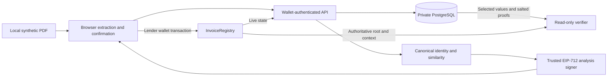
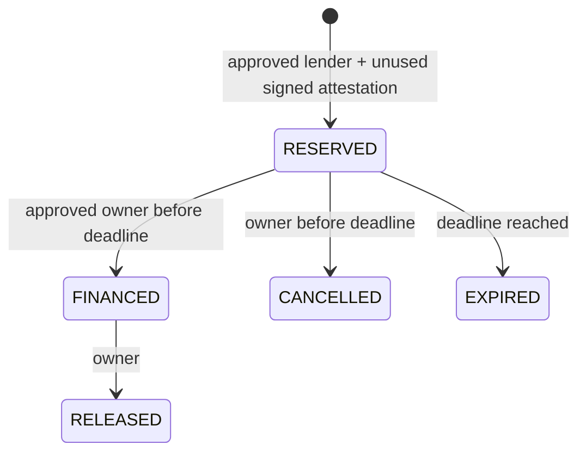

# Architecture and trust boundary

## Representations

* PDF digest: SHA-256 over original bytes, before PDF.js transfers its input buffer.
* Identity token: HMAC-SHA-256 over a JSON array of schema version, supplier country, identifier type, identifier, invoice namespace and invoice number. All string fields use NFKC, trimming, whitespace collapse and uppercase. Punctuation and leading zeros remain significant. Amount, lender and layout are excluded.
* Evidence root: OpenZeppelin StandardMerkleTree over `[uint32 schema, bytes32 context, string fieldPath, string canonicalValue, bytes32 randomSalt]`. Every field uses an independent 256-bit salt; contexts are unique 256-bit random values.
* Claim ID: monotonically increasing registry-local ID for each financing cycle. Claim roots and owner are immutable.

These representations serve different purposes. A matching token is deterministic within one deployment secret. An evidence root changes for each submission, even when the underlying invoice is repeated.

## Lifecycle

Reservations last 900 seconds; attestations last 300 seconds. A reserve atomically finalises an expired predecessor. FINANCED never expires with time. Revoked lenders can cancel or release existing claims; they cannot reserve or confirm. The admin manages roles but has no privileged claim-rewrite operation.

The UI follows the configured confirmation policy (one locally by default, two in the Amoy guide). This is an application policy, not mathematical finality. Receipts include the reservation transaction and block reference, plus an observation block. The web verifier checks selected leaves against a live root. The independent CLI also checks canonical reservation inclusion directly through the configured RPC without the app API/database. Completely offline chain-inclusion verification is not implemented.

## Private API

Signed login challenges bind origin, wallet, chain, random nonce and expiry. Successful verification consumes the challenge and stores only a hash of the one-hour session token. Session cookies are HttpOnly and SameSite=Strict; HTTPS origins set Secure. POST operations require the configured origin. Private queries enforce submission ownership. Cross-lender matching returns opaque references and scores, not full counterparty invoices.

Submissions and attestations have owner-scoped idempotency keys. Concurrent approval retries are serialised in a database transaction and return the same signed payload/nonce. A reused key with different submission/analysis is rejected. Analysis scans at most 10,000 historical submissions; it explicitly labels a truncated scan and withholds attestations. Atomic database counters bound login/analysis requests. The signer checks live membership and exact claim state; contract checks resolve the race after that snapshot.

PostgreSQL is not a source of accepted financing state. Event replay uses checkpoints and overlap, detects changed canonical checkpoint hashes, removes orphaned tail events, and rebuilds bounded ranges transactionally. Decisions always query the contract. The SQL reference separately enforces typed approvals, membership, nonce consumption, advisory locks, an active-token unique index and owner transitions, and issues signed receipts. Its tests and measured lifecycle are included; it is not the main application authority.

## Workspace and transaction recovery

Private submission/history views restore from authenticated server records. The browser stores only public configuration and a bounded transaction-hash journal with submission references; it does not persist invoice fields or complete evidence packages in localStorage. Transaction registration verifies sender, destination, chain and decoded operation; reservations must bind the owner's submitted token/root/context. Lifecycle association is derived from the immutable claim commitments.

Reconciliation checks receipt success, canonical block hash and configured confirmations. Pending/unknown/failed/reorganised records cannot become an accepted claim merely through a database edit. A dropped transaction is labelled UNKNOWN rather than assigned a fabricated success or definite cause. Unavailable RPCs fail the request rather than infer financing. A cached public ABI/address permits direct wallet lifecycle actions during a backend outage; new analysis fails closed.
